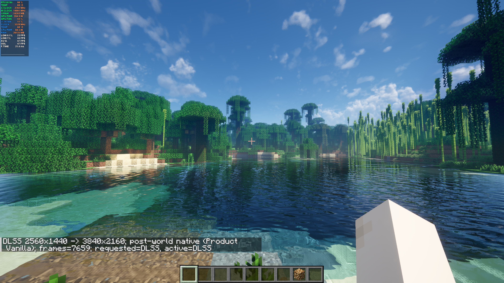
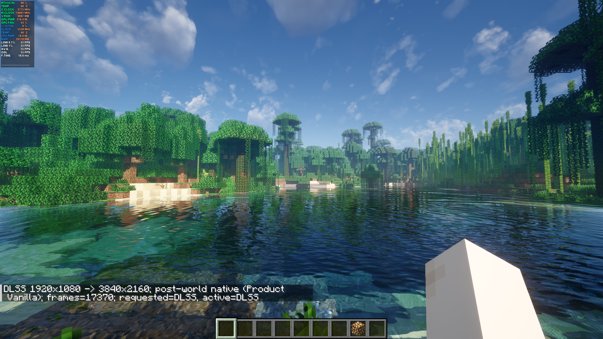

# Titanium

Minecraft Java 26.2向けのクライアント専用Fabric MOD。  
OpenGL環境でワールドの描画解像度を制御し、NVIDIA DLSS・DLAAまたはBilinearによる出力を行う。

## 動作要件

- Minecraft 26.2(今後対応予定？)
- Fabric Loader 0.19.5以上、Fabric API、Cloth Config 26.2.155以上
- DLSS・DLAAには対応するNVIDIA RTX GPUとドライバーが必要
- シェーダーパック連携はIris 1.11.2 / Sodium 0.9.1向け
- DLSSを使用する場合は影mod側のTAA及びAAをOFFにしてください （ありえないくらいボヤケます）

## 導入と設定

DLSSランタイム同梱版の`titanium-0.1.1-dlss.jar`を`mods`へ配置する。
設定画面は`/titanium config`、Mod Menu、またはキー設定の「Titaniumの設定を開く」から開く。キーの既定値は未設定。設定は`config/titanium.json`に保存する。

| 項目 | 内容 | 既定       |
| --- | --- |------------|
| アップスケーラー | Bilinear / NVIDIA DLSS |
| Bilinear描画倍率 | 0.25〜1.0| 2/3(0.666) |
| DLSS品質 | Ultra Performance / Performance / Quality / Balanced / DLAA | Quality    |
| DLSS連携 | Standard / Enhanced| Standard   |
| プリセット | Default / J / K / L / M| Default    |
| 出力シャープネス | 0.0〜1.0| 0          |
| 地形テクスチャの細部保持 | 解像度に応じたLOD補正| True       |
| GUIフレームペーシング | 任意の試験機能| False      |

`/titanium`で描画寸法・有効な描画経路・退避理由を確認できる。`/titanium reload`は設定ファイルを再読み込みする。  
DLSSの実行条件を満たさない場合はBilinearへ退避する。

## ベンチマーク

### 測定環境
※参考程度

| 項目             | 条件                                                                                                                                                                                                  |
|------------------|-------------------------------------------------------------------------------------------------------------------------------------------------------------------------------------------------------|
| CPU              | Intel Core i7-14700K                                                                                                                                                                                  |
| GPU              | NVIDIA GeForce RTX 5070 Ti                                                                                                                                                                            |
| RAM              | DDR4 64GB 3600MHz CL16                                                                                                                                                                                |
| Mod環境          | 軽量化複数                                                                                                                                                                                            |
| シェーダーパック | [Ray-0.1.0a0-c7fa099-nightly](https://github.com/kuwacom/ray)（設定は既定）                                                                                                                           |
| 出力解像度       | 3840 × 2160（4K）                                                                                                                                                                                     |
| DLSSプリセット   | Default（既定）                                                                                                                                                                                       |
| 比較条件         | ジャングルの水辺を同じ構図で比較。DLSS有効時は品質のみ切り替え、基準のNativeはDLSSを無効化。計測開始から20秒ほど放置した値を参考値とする。 DLSS有効時は影modのTAAをOFF。ネイティブ時にはTAAを有効化。 |

### 計測結果

| モード | 内部描画解像度 | 平均FPS | Native比 | 1% Low（FPS） | 0.1% Low（FPS） | VRAM使用量（MB） |
| --- | ---: | ---: | ---: | ---: | ---: | ---: |
| DLAA | 3840 × 2160 | 28 | +3.7% | 26 | 25 | 12,270 |
| Quality | 2560 × 1440 | 47 | +74.1% | 44 | 23 | 10,393 |
| Balanced | 2227 × 1253 | 54 | +100.0% | 51 | 29 | 9,918 |
| Performance | 1920 × 1080 | 55 | +103.7% | 52 | 51 | 9,887 |
| Ultra Performance | 1280 × 720 | 77 | +185.2% | 71 | 69 | 9,282 |
| Native（DLSSオフ） | 3840 × 2160 | 27 | 基準 | 25 | 22 | 11,801 |

### 画質比較

画像をクリックすると4K版を開ける。

| DLAA | Quality | Balanced |
| :---: | :---: | :---: |
| [](img/benchmark/dlaa.webp) | [](img/benchmark/quality.webp) | [](img/benchmark/balanced.webp) |

| Performance | Ultra Performance | Native（DLSSオフ） |
| :---: | :---: | :---: |
| [](img/benchmark/performance.webp) | [](img/benchmark/ultra-performance.webp) | [](img/benchmark/native.webp) |

## 描画経路

Standardはワールド出力をDLSSへ渡す標準経路。  
Enhancedは対応するパックの描画構造を解析し、ジッターやTAAの担当を実行時に調整する。対応するSolas系のDLAA経路では、実際に描画された切り抜き地形に元パックのTAAを使用し、残りの領域にDLAAを使用する。
Enhancedの対応判定は読み込んだシェーダーと実描画に基づく。パックのZIPや設定ファイルの編集は不要。解析・変換に失敗した場合はStandardへ退避する。連携モードの切り替え時はIrisを再読み込みする。（試験昨日）

## 制約

- 遠景の葉の隙間や微細構造は、Native TAAより失われる場合がある。
- MVは主にカメラ移動に対応し、葉の揺れ・水・エンティティ・腕の変形への対応は限定的。
- Enhancedの対応範囲はパックの描画構造と有効なエフェクトに依存する。
- 手動プリセットは画質保証の対象外。NVIDIA App・ドライバーの設定がモデル選択に影響する場合がある。
- RenderScaleとの同時利用には非対応。

## ソースからのビルド

Java 25、CMake 3.24以上、Visual Studio 2022のC++ビルドツールが必要。CMakeはPATH、Visual Studio 2022付属ツールの順で自動検出する。`powershell.exe`をPATHから実行できる環境で使用する。

```powershell
.\gradlew.bat build
```

SDK未指定のビルドはBilinearを利用できる。DLSSランタイム同梱版はNVIDIA DLSS SDK 310.9.1と対応するVisual C++ランタイムを用意してビルドする。

IDEから実行する場合は、Git管理対象外の`.local/build.properties`に配置先を保存できる。相対パスはプロジェクトのルートを基準とする。コマンドラインの`-P`指定が優先される。

```properties
titaniumNgxRoot=.local/vendor/dlss-310.9.1
titaniumVcRuntimeRoot=.local/vendor/vc-runtime
```

```powershell
.\gradlew.bat buildDlssRelease `
  -PtitaniumNgxRoot="<DLSS SDKの展開先>" `
  -PtitaniumVcRuntimeRoot="<Visual C++ランタイムの格納先>"
```

同梱対象のDLLはバージョン・ハッシュ・署名を照合する。必要なVisual C++ランタイムは14.51.36247.0。CMakeの実行ファイルは`-PtitaniumCmake=<実行ファイル>`で指定可能。既存の対応DLLを使用する場合は`-PtitaniumNativeLibrary=<titanium_native.dll>`を指定する。成果物は`build/libs`へ出力する。

## ライセンス

TitaniumのコードはMITライセンス。NVIDIA DLSSおよびMicrosoftランタイムには各提供元の条件が適用される。配布JAR内の`META-INF/licenses`に同梱するライセンスと通知を参照。
