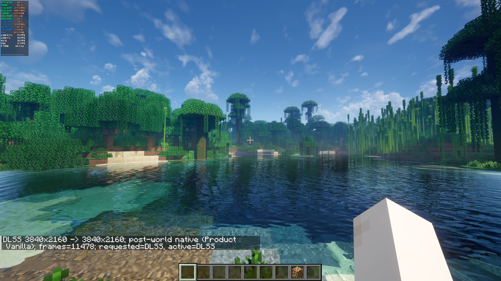
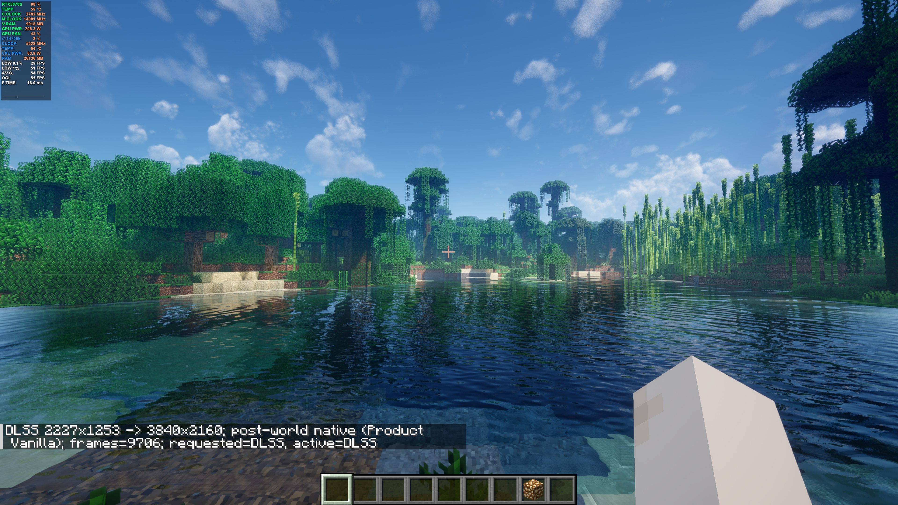
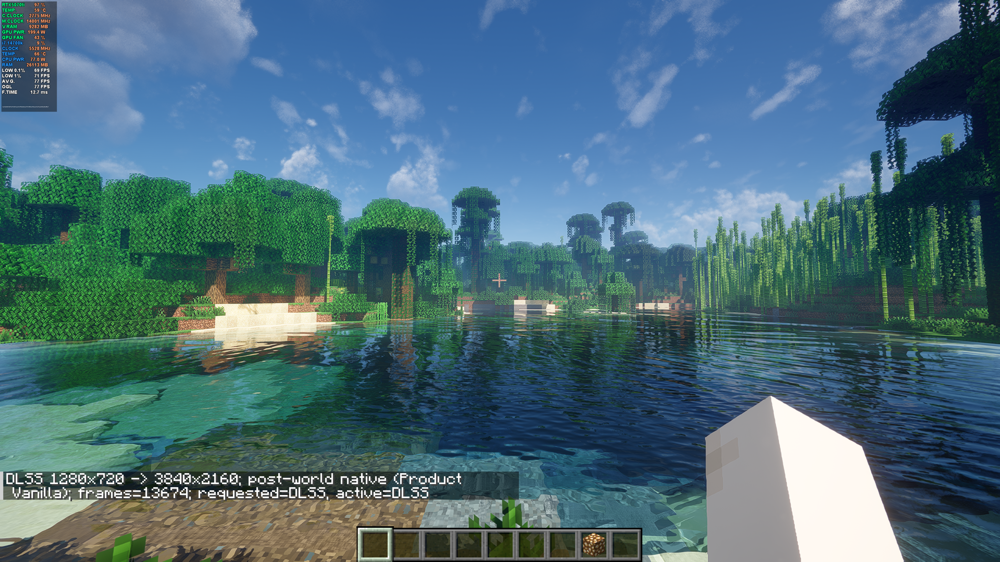
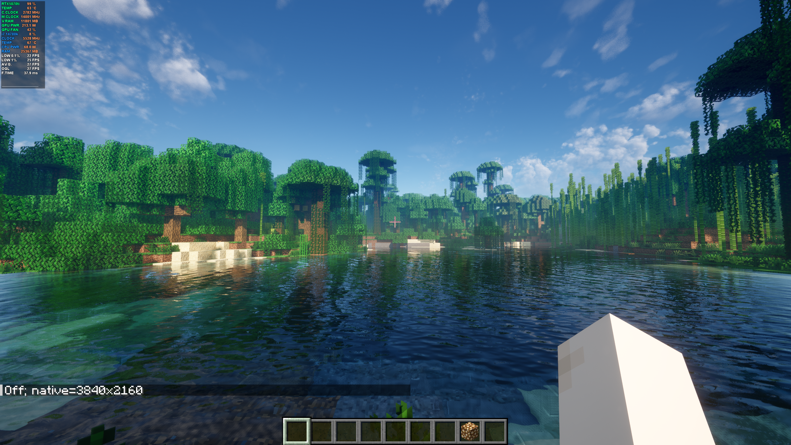

# Titanium

English | [日本語](README.ja.md)

Titanium is a client-side Fabric mod for Minecraft Java Edition 26.2. It controls the world's render resolution in OpenGL and supports NVIDIA DLSS, DLAA, and bilinear scaling.

## Requirements

- Minecraft 26.2 (support tentative)
- Fabric Loader 0.19.5 or later, Fabric API, and Cloth Config 26.2.155 or later
- A compatible NVIDIA RTX GPU and driver for DLSS and DLAA
- Shader pack integration targets Iris 1.11.2 and Sodium 0.9.1
- When using DLSS, disable TAA and other anti-aliasing in the shader pack to avoid excessive blur.

## Installation and configuration

Place `titanium-0.1.1-dlss.jar`, which includes the DLSS runtime, in the `mods` folder.

Open the settings with `/titanium config`, through Mod Menu, or with the key binding to open Titanium's settings. The key is unassigned by default. Settings are saved in `config/titanium.json`.

| Setting | Options | Default |
| --- | --- | --- |
| Upscaler | Bilinear / NVIDIA DLSS | |
| Bilinear render scale | 0.25–1.0 | 2/3 (0.666) |
| DLSS quality | Ultra Performance / Performance / Quality / Balanced / DLAA | Quality |
| DLSS integration | Standard / Enhanced | Standard |
| Preset | Default / J / K / L / M | Default |
| Output sharpness | 0.0–1.0 | 0 |
| Preserve terrain texture detail | Resolution-dependent LOD adjustment | On |
| GUI frame pacing | Optional experimental feature | Off |

Run `/titanium` to check the render dimensions, active rendering path, and fallback reason. Run `/titanium reload` to reload the configuration file. Titanium falls back to Bilinear if the DLSS requirements are unmet.

## Benchmark

### Test setup

These results are for reference.

| Item | Details |
| --- | --- |
| CPU | Intel Core i7-14700K |
| GPU | NVIDIA GeForce RTX 5070 Ti |
| RAM | 64 GB DDR4-3600 CL16 |
| Mod setup | Several performance mods |
| Shader pack | [Ray-0.1.0a0-c7fa099-nightly](https://github.com/kuwacom/ray) (default settings apart from TAA as described below) |
| Output resolution | 3840 × 2160 (4K) |
| DLSS preset | Default |
| Test method | Same view of a jungle waterfront in each run. Readings were taken after about 20 seconds with the camera stationary. Only the quality mode varied across DLSS runs, with shader pack TAA off. The native baseline used DLSS off and shader pack TAA on. |

### Results

| Mode | Internal render resolution | Avg. FPS | Avg. FPS vs. native | 1% low (FPS) | 0.1% low (FPS) | VRAM usage (MB) |
| --- | ---: | ---: | ---: | ---: | ---: | ---: |
| DLAA | 3840 × 2160 | 28 | +3.7% | 26 | 25 | 12,270 |
| Quality | 2560 × 1440 | 47 | +74.1% | 44 | 23 | 10,393 |
| Balanced | 2227 × 1253 | 54 | +100.0% | 51 | 29 | 9,918 |
| Performance | 1920 × 1080 | 55 | +103.7% | 52 | 51 | 9,887 |
| Ultra Performance | 1280 × 720 | 77 | +185.2% | 71 | 69 | 9,282 |
| Native (DLSS off) | 3840 × 2160 | 27 | Baseline | 25 | 22 | 11,801 |

### Image quality comparison

Click any screenshot to open the full 4K image.

| DLAA | Quality | Balanced |
| :---: | :---: | :---: |
| [](img/benchmark/dlaa.webp) | [](img/benchmark/quality.webp) | [](img/benchmark/balanced.webp) |

| Performance | Ultra Performance | Native (DLSS off) |
| :---: | :---: | :---: |
| [](img/benchmark/performance.webp) | [](img/benchmark/ultra-performance.webp) | [](img/benchmark/native.webp) |

## Rendering paths

Standard passes the rendered world image to DLSS.

Enhanced analyzes the rendering pipeline of supported shader packs and adjusts how jitter and TAA are handled at runtime. In the DLAA path for supported Solas-based packs, it applies the pack's TAA to rendered cutout terrain and DLAA to the rest of the image.

Enhanced determines compatibility from the loaded shaders and actual rendering. It works with the existing shader pack ZIP and configuration. Titanium falls back to Standard if analysis or transformation fails. Switching integration modes reloads Iris. This feature is experimental.

## Limitations

- Distant gaps between leaves and other fine details may be less visible than with native TAA.
- Motion vectors primarily cover camera movement. Coverage for swaying foliage, water, and deformations of entities and the player arm is limited.
- Enhanced support depends on the shader pack's rendering pipeline and enabled effects.
- Image quality may vary with manually selected presets. NVIDIA App and driver settings can affect model selection.
- RenderScale is incompatible with Titanium.

## Building from source

The build requires Java 25, CMake 3.24 or later, and the Visual Studio 2022 C++ build tools. The build checks PATH first for CMake, then the copy bundled with Visual Studio 2022. Make sure `powershell.exe` is available on PATH.

```powershell
.\gradlew.bat build
```

A build without the DLSS SDK supports Bilinear. To bundle the DLSS runtime, provide NVIDIA DLSS SDK 310.9.1 and the matching Visual C++ runtime.

For IDE builds, you can store the paths in the Git-ignored `.local/build.properties`. Relative paths resolve from the project root. Command-line `-P` options take precedence.

```properties
titaniumNgxRoot=.local/vendor/dlss-310.9.1
titaniumVcRuntimeRoot=.local/vendor/vc-runtime
```

```powershell
.\gradlew.bat buildDlssRelease `
  -PtitaniumNgxRoot="<DLSS SDK directory>" `
  -PtitaniumVcRuntimeRoot="<Visual C++ runtime directory>"
```

The build checks the versions, hashes, and signatures of the DLLs it bundles. The required Visual C++ runtime version is 14.51.36247.0. Use `-PtitaniumCmake=<executable>` to specify a CMake executable or `-PtitaniumNativeLibrary=<titanium_native.dll>` to use an existing compatible native library. Build artifacts are written to `build/libs`.

## License

Titanium's source code is licensed under MIT. NVIDIA DLSS and the Microsoft runtime are subject to their respective providers' terms. See `META-INF/licenses` in the distributed JAR for the bundled licenses and notices.
